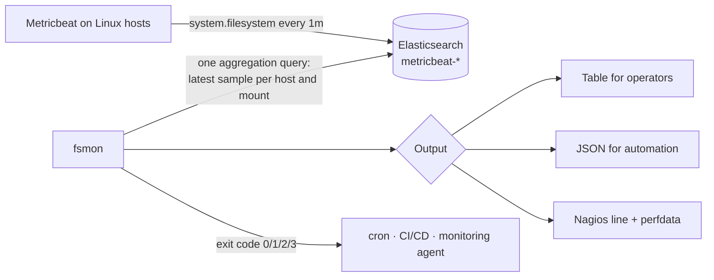

# elastic-linux-observability

[](https://github.com/ebrahimsidat/elastic-linux-observability/actions/workflows/ci.yml)


Linux infrastructure observability with the Elastic Stack: a reproducible **Elasticsearch + Kibana + Metricbeat lab**,
operational assets (index lifecycle policy and a Kibana alert rule), and **`fsmon`**, a command-line check that turns
Metricbeat file system data into actionable capacity alerts with Nagios-compatible exit codes.

## Components

| Component | Description |
|---|---|
| [`fsmon`](src/fsmon) | Reports the latest file system usage for every host and mount point from Metricbeat data, classifies it against thresholds and exits `0/1/2/3` (OK, WARNING, CRITICAL, UNKNOWN) for use in cron, CI/CD gates, Nagios, Icinga or Zabbix |
| [`lab/`](lab) | Docker Compose lab: single-node Elasticsearch with security enabled, Kibana, and Metricbeat collecting CPU, memory, load, network, process and file system metrics with the bundled host dashboards |
| [`elasticsearch/`](elasticsearch) | ILM policy (daily rollover, warm after 7 days, delete after 30) and a Kibana *Elasticsearch query* rule alerting on file systems above 90% used, plus a loader script |

## How fsmon works



A single `terms → terms → top_metrics` aggregation returns only the most recent sample for each host and mount point,
so the check stays fast even across large fleets and long retention periods.

## Quick start

```bash
pip install .
export ES_URL=https://elasticsearch.example.com:9200
export ES_API_KEY=...                      # or ES_USERNAME / ES_PASSWORD

fsmon                                      # table, default thresholds 80% / 90%
fsmon --warning 85 --critical 95 --exclude-mount '/snap/*'
fsmon --host 'db*' --format json           # automation-friendly output
fsmon --format nagios                      # monitoring-agent output with performance data
```

Example table output:

```text
STATUS    HOST   MOUNT           USED   AVAILABLE  SIZE
CRITICAL  db01   /var/lib/pgsql  93.5%  32.5 GiB   500.0 GiB
WARNING   web01  /var            83.0%  17.0 GiB   100.0 GiB
OK        db01   /               51.0%  49.0 GiB   100.0 GiB
OK        web01  /               42.0%  58.0 GiB   100.0 GiB
```

| Option | Default | Description |
|---|---|---|
| `--url` | `$ES_URL` or `http://localhost:9200` | Elasticsearch endpoint |
| `--index` | `metricbeat-*` | Index pattern containing Metricbeat data |
| `--since` | `15m` | Look-back window for the latest sample |
| `--host` | all hosts | Wildcard filter on `host.name` |
| `--warning` / `--critical` | `80` / `90` | Thresholds in percent |
| `--exclude-mount` | none | Glob of mount points to ignore (repeatable) |
| `--format` | `table` | `table`, `json` or `nagios` |
| `--ca-cert` / `--insecure` | verify with system CAs | TLS options |

Credentials are read only from the environment (`ES_API_KEY`, or `ES_USERNAME` and `ES_PASSWORD`) and never from
command-line arguments, so they do not appear in shell history or process listings.

## Running the lab

```bash
cd lab
cp .env.example .env          # set strong passwords and a 32+ character encryption key
docker compose up -d
```

Open Kibana at <http://localhost:5601>, sign in as `elastic`, and open the **[Metricbeat System] Host overview**
dashboard. Then load the operational assets and run fsmon against the lab:

```bash
ES_PASSWORD=... bash ../elasticsearch/load-assets.sh
ES_USERNAME=elastic ES_PASSWORD=... fsmon
```

## Quality and testing

| Layer | What runs in CI |
|---|---|
| Static analysis | ruff (lint and format), mypy in strict mode |
| Unit tests | 26 tests on Python 3.10 to 3.13, covering thresholds, parsing, output formats, exit codes and error handling |
| Integration test | A real Elasticsearch 8 service is seeded with Metricbeat-shaped data; fsmon must pick the newest sample per file system and return the correct status and exit code |
| Lab and assets | `docker compose config`, JSON validation, ShellCheck |
| Security | bandit and pip-audit |

## Operational guidance

Capacity thresholds, alert routing and retention recommendations are covered in [docs/operations.md](docs/operations.md).

## License

Released under the [MIT License](LICENSE). © 2026 Ebrahim Sidat.
